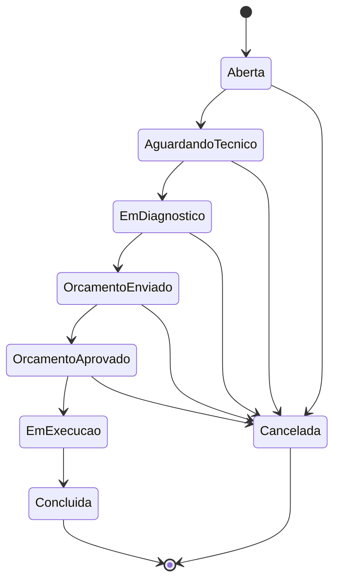

# AV2 — Evolução da Solicitação

Responsável: Bernardo Awano Muniz
Branch: `feature/bernardo-ciclo-solicitacao`

## Escopo

Esta parte da AV2 trata da evolução da solicitação de atendimento:

1. Novos estados da solicitação.
2. Cancelamento pelo cliente.
3. Acompanhamento completo por histórico de alterações de status.

Autenticação, diagnóstico, orçamento, matching, execução e avaliação pertencem aos demais integrantes e não foram implementados aqui.

## Estados da solicitação

Definidos em `backend/Assistencia.Api/Enums/StatusSolicitacao.cs`. O valor é armazenado como inteiro no banco.

| Valor | Estado | Significado |
|---|---|---|
| 1 | `Aberta` | Solicitação criada pelo cliente. Estado inicial. |
| 2 | `AguardandoTecnico` | Aguardando definição do técnico. |
| 3 | `EmDiagnostico` | Equipamento em diagnóstico. |
| 4 | `OrcamentoEnviado` | Orçamento enviado ao cliente. |
| 5 | `OrcamentoAprovado` | Orçamento aprovado pelo cliente. |
| 6 | `EmExecucao` | Serviço em execução. |
| 7 | `Concluida` | Serviço finalizado. Estado final. |
| 8 | `Cancelada` | Solicitação cancelada. Estado final. |

Os estados intermediários são uma proposta inicial e podem ser ajustados na integração com as partes dos colegas.

## Diagrama de estados



## Regras de negócio

As regras ficam na entidade `Solicitacao` (`backend/Assistencia.Api/Models/Solicitacao.cs`). O controller não repete nenhuma delas.

### Transições — `AlterarStatus(novoStatus)`

- Toda solicitação nasce em `Aberta` (construtor).
- A solicitação só avança para o estado imediatamente seguinte na sequência `Aberta → AguardandoTecnico → EmDiagnostico → OrcamentoEnviado → OrcamentoAprovado → EmExecucao → Concluida`.
- Não é possível pular etapas, voltar para um estado anterior ou "alterar" para o mesmo estado. Nesses casos é lançada `InvalidOperationException` com a mensagem `Transição de status inválida.`
- Solicitações `Concluida` ou `Cancelada` não aceitam nenhuma alteração. É lançada `InvalidOperationException` com a mensagem `Não é possível alterar uma solicitação encerrada.`
- `AlterarStatus(Cancelada)` é delegado ao método `Cancelar()`, aplicando as mesmas regras de cancelamento.

### Cancelamento — `Cancelar()`

- Permitido em qualquer estado anterior a `EmExecucao`: `Aberta`, `AguardandoTecnico`, `EmDiagnostico`, `OrcamentoEnviado` e `OrcamentoAprovado`.
- Proibido em `EmExecucao`, `Concluida` e `Cancelada`. É lançada `InvalidOperationException` com a mensagem `Não é possível cancelar esta solicitação.`

Quando uma operação é rejeitada, o status não muda e nenhum registro é adicionado ao histórico.

## Histórico

### Funcionamento

- A entidade `Solicitacao` possui a coleção `Historico` (`ICollection<HistoricoSolicitacao>`).
- `AlterarStatus` e `Cancelar` usam o método privado `RegistrarAlteracaoStatus`, que:
  1. guarda o status anterior;
  2. atualiza o status atual;
  3. adiciona um `HistoricoSolicitacao` à coleção.
- Cada registro (`backend/Assistencia.Api/Models/HistoricoSolicitacao.cs`) guarda: `SolicitacaoId`, `StatusAnterior`, `NovoStatus` e `DataAlteracao` (UTC).
- Somente alterações de status geram registro. A abertura não gera registro, pois não há status anterior; a data de abertura continua em `Solicitacao.DataCriacao`.

### Persistência

Configurada em `backend/Assistencia.Api/Data/AppDbContext.cs`:

- `DbSet<HistoricoSolicitacao> HistoricosSolicitacoes`.
- Relacionamento um-para-muitos: uma `Solicitacao` possui vários `HistoricoSolicitacao`, pela chave estrangeira `SolicitacaoId`.
- Exclusão em cascata: ao excluir uma solicitação, seu histórico é excluído junto. É o mesmo critério já usado em `HistoricoSelecaoTecnico`.
- Índice em `(SolicitacaoId, DataAlteracao)` para a consulta ordenada.

Como o registro é adicionado à coleção da solicitação, um único `SaveChangesAsync()` grava a alteração de status e o histórico na mesma transação.

### Migration

Migration criada: `20261117173820_AddHistoricoSolicitacao` (`backend/Assistencia.Api/Migrations/`).

- `Up`: cria a tabela `HistoricosSolicitacoes` (`Id`, `SolicitacaoId`, `StatusAnterior`, `NovoStatus`, `DataAlteracao`), com chave estrangeira em cascata para `Solicitacoes` e o índice `IX_HistoricosSolicitacoes_SolicitacaoId_DataAlteracao`.
- `Down`: remove a tabela `HistoricosSolicitacoes`.
- Nenhuma tabela ou coluna existente é alterada. O enum de status não exige alteração de esquema.

Para aplicar no banco SQLite local, a partir da raiz do repositório:

```bash
dotnet tool restore
dotnet ef database update --project backend/Assistencia.Api
```

## Endpoints

Implementados em `backend/Assistencia.Api/Controllers/SolicitacoesController.cs`. Seguem o mesmo padrão de identificação do cliente já usado pelos endpoints existentes: o `clienteId` vem na rota e a solicitação só é encontrada se pertencer a esse cliente. Caso contrário, a resposta é `404`.

Os valores dos exemplos abaixo são ilustrativos.

### Consultar histórico

`GET /api/solicitacoes/cliente/{clienteId}/{id}/historico`

- Retorna os registros em ordem cronológica (`DataAlteracao`, com desempate por `Id`).
- Os status são retornados como texto e a data em UTC.
- Uma solicitação sem alterações retorna lista vazia.

Resposta `200 OK`:

```json
[
  {
    "id": 1,
    "solicitacaoId": 5,
    "statusAnterior": "Aberta",
    "novoStatus": "AguardandoTecnico",
    "dataAlteracao": "2026-11-17T18:00:00Z"
  },
  {
    "id": 2,
    "solicitacaoId": 5,
    "statusAnterior": "AguardandoTecnico",
    "novoStatus": "Cancelada",
    "dataAlteracao": "2026-11-17T18:10:00Z"
  }
]
```

Resposta `404 Not Found` (solicitação inexistente ou de outro cliente):

```json
{ "erro": "Solicitação não encontrada." }
```

### Cancelar solicitação

`POST /api/solicitacoes/cliente/{clienteId}/{id}/cancelar` (sem corpo)

- Chama `Solicitacao.Cancelar()` e grava status e histórico com um único `SaveChangesAsync()`.

Resposta `200 OK` (mesmo formato do endpoint de consulta da solicitação):

```json
{
  "id": 5,
  "numero": "SOL-20261117-1A2B3C4D",
  "descricaoProblema": "Notebook não liga.",
  "status": "Cancelada",
  "dataCriacao": "2026-11-17T17:55:00Z",
  "clienteId": 1,
  "equipamento": { "id": 1, "tipo": "Notebook", "marca": "Dell", "modelo": "Inspiron" },
  "especialidade": { "id": 1, "nome": "Notebooks" }
}
```

Resposta `400 Bad Request` (solicitação em `EmExecucao`, `Concluida` ou `Cancelada`):

```json
{ "erro": "Não é possível cancelar esta solicitação." }
```

Resposta `404 Not Found` (solicitação inexistente ou de outro cliente):

```json
{ "erro": "Solicitação não encontrada." }
```

## Testes

Projeto: `backend/Assistencia.Api.Tests` (xUnit). Os testes de API usam SQLite em memória, no mesmo padrão dos testes existentes. Antes das verificações no banco, o rastreamento do EF é limpo (`ChangeTracker.Clear()`), garantindo que os dados conferidos foram lidos do banco.

### `CicloSolicitacaoTests.cs` — regras da entidade

| Teste | Cenário |
|---|---|
| `SolicitacaoNovaDeveIniciarSemHistorico` | Nova solicitação em `Aberta` e com histórico vazio |
| `DeveAvancarParaProximoStatus` | `Aberta → AguardandoTecnico` |
| `DevePercorrerTodasAsEtapasAteConcluida` | Fluxo completo até `Concluida` |
| `NaoDevePularEtapas` (4 casos) | Pular etapas é rejeitado |
| `NaoDeveVoltarParaStatusAnterior` (3 casos) | Retroceder é rejeitado |
| `NaoDeveAlterarParaOMesmoStatus` | `Aberta → Aberta` é rejeitado |
| `NaoDeveAlterarSolicitacaoEncerrada` (4 casos) | `Concluida` e `Cancelada` não aceitam alterações |
| `DeveCancelarAntesDaExecucao` (5 casos) | Cancelamento de `Aberta` até `OrcamentoAprovado` |
| `NaoDeveCancelarEmExecucao` | Cancelamento rejeitado em `EmExecucao` |
| `NaoDeveCancelarSolicitacaoConcluida` | Cancelamento rejeitado em `Concluida` |
| `NaoDeveCancelarSolicitacaoJaCancelada` | Cancelamento rejeitado em `Cancelada` |
| `AlterarStatusParaCanceladaDeveCancelar` | `AlterarStatus(Cancelada)` cancela |
| `AlterarStatusParaCanceladaEmExecucaoDeveSerRejeitado` | `AlterarStatus(Cancelada)` respeita a regra de cancelamento |
| `CadaAlteracaoDeveGerarUmRegistroNoHistorico` | Um registro por alteração |
| `HistoricoDeveGuardarStatusAnteriorENovoStatus` | Pares anterior/novo corretos no fluxo completo |
| `RegistroDeveGuardarDataDaAlteracaoEmUtc` | Data da alteração em UTC e vínculo com a solicitação |

Os testes de rejeição verificam também a mensagem de erro, que o status não mudou e que o histórico não ganhou registros.

### `SolicitacoesTests.cs` — persistência e API

| Teste | Cenário |
|---|---|
| `DevePersistirHistoricoAoSalvarAlteracoes` | Registros gravados no banco com status corretos |
| `DeveConsultarHistoricoEmOrdemCronologica` | `GET .../historico` retorna 3 registros em ordem, com campos corretos |
| `HistoricoDeSolicitacaoSemAlteracoesDeveSerVazio` | `GET .../historico` retorna lista vazia |
| `NaoDeveConsultarHistoricoDeOutroCliente` | `404` para cliente que não é o dono |
| `NaoDeveConsultarHistoricoDeSolicitacaoInexistente` | `404` para solicitação inexistente |
| `DeveCancelarPeloEndpointERegistrarHistorico` | `POST .../cancelar` retorna `Cancelada`, grava status e registro `OrcamentoEnviado → Cancelada` |
| `NaoDeveCancelarPeloEndpointAposInicioDaExecucao` (3 casos) | `400` em `EmExecucao`, `Concluida` e `Cancelada`, sem alterar status nem histórico |
| `NaoDeveCancelarSolicitacaoDeOutroCliente` | `404` para cliente que não é o dono, sem alterar a solicitação |
| `NaoDeveCancelarSolicitacaoInexistente` | `404` para solicitação inexistente |

### Resultados

Ambiente: Windows 11, .NET SDK 10.0.401.

```bash
dotnet test backend/Assistencia.Api.Tests
```

| Execução | Aprovados | Com falha | Total |
|---|---|---|---|
| Antes da implementação (linha de base) | 29 | 0 | 29 |
| Após a implementação — todos os testes | 68 | 0 | 68 |
| `CicloSolicitacaoTests` | 28 | 0 | 28 |
| `SolicitacoesTests` (14 existentes + 11 novos) | 25 | 0 | 25 |

Saída da execução completa:

```text
Aprovado!  – Com falha:     0, Aprovado:    68, Ignorado:     0, Total:    68, Duração: 1 s - Assistencia.Api.Tests.dll (net10.0)
```

O build (`dotnet build backend/Assistencia.Api`) terminou com 0 avisos e 0 erros.

## Commits

| Commit | Descrição |
|---|---|
| `01abacc` | feat: adiciona estados e historico da solicitacao |
| `54ec01a` | feat: persiste historico da solicitacao |
| `8a26a93` | feat: adiciona endpoints de historico e cancelamento da solicitacao |
| `d04aa3a` | test: cobre ciclo, cancelamento e historico da solicitacao |

## Pontos de integração com os colegas

- **Matching e reencaminhamento (Karina):** o fluxo de seleção de técnico deve chamar `AlterarStatus(StatusSolicitacao.AguardandoTecnico)` e os estados seguintes. Um eventual retorno de `AguardandoTecnico` para `Aberta` no reencaminhamento não é permitido hoje e precisa ser combinado.
- **Diagnóstico e orçamento (Luiz):** usará `EmDiagnostico`, `OrcamentoEnviado` e `OrcamentoAprovado`. Hoje, um orçamento recusado só pode levar ao cancelamento; outro caminho exige uma regra combinada.
- **Execução, finalização e avaliação (Maria Eduarda):** usará `EmExecucao` e `Concluida`.
- **Autenticação (Kelvin):** o `clienteId` da rota deve passar a vir da identidade autenticada.
- **Migrations:** migrations criadas em paralelo nas branches geram conflito no `AppDbContextModelSnapshot.cs`. A solução é atualizar a branch com a `main` e regenerar a migration.
